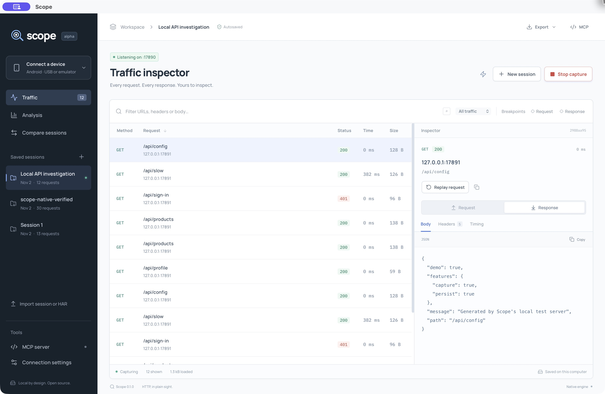
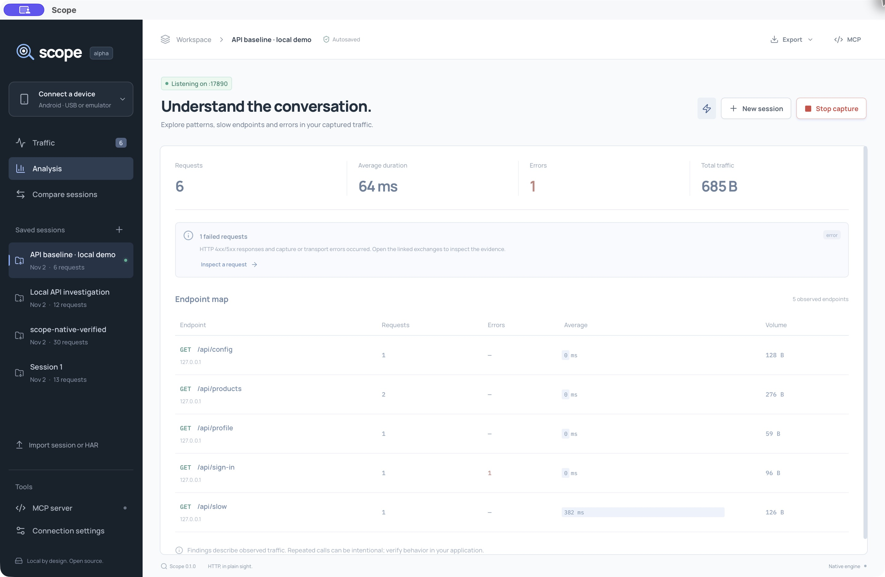

# Scope

**Inspect Android HTTP traffic. Change it live. Keep every session.**

Scope is an open-source desktop HTTP(S) debugger with a Rust capture engine, an Android ADB/Frida adapter, and an MCP server that lets your agent inspect the same saved evidence you see.

[Download the alpha](https://github.com/SculptTechProject/scope/releases) · [Getting started](docs/GETTING_STARTED.md) · [Android setup](docs/ANDROID.md) · [MCP](docs/MCP.md) · [Roadmap](ROADMAP.md)



> **v0.1.0-alpha.1** (app version 0.1.0). macOS on Apple Silicon is the first locally verified desktop target. Windows and Linux have build workflows; runtime and device support on those hosts are still being validated. [What has actually been tested →](docs/VERIFICATION.md)

## What you can do

- **Capture HTTP and HTTPS** through a localhost proxy and a generated Scope CA.
- **Choose an Android app** with ADB discovery, device-wide proxy capture, or selected-process Frida instrumentation with selectable proxy, trust, pinning and root-hiding hooks.
- **Pause and edit requests or responses**, continue or abort them, and inspect the original alongside the edited message. Replay creates a separate request.
- **Keep named sessions in SQLite.** Bodies, repeated headers, timing and failures survive app restarts. Import/export HAR or a lossless Scope archive.
- **Analyze observed traffic:** endpoint counts, errors, sizes, latency percentiles, repeated requests and differences between two sessions.
- **Connect an MCP client:** search, inspect, analyze and compare explicitly shared sessions. Replay is opt-in.

Local capture, saved sessions, export and MCP need no account or subscription. Scope's built-in analysis runs locally without an LLM. An external MCP client may send shared results to its configured model provider.

## Try it

Download the [macOS arm64 alpha](https://github.com/SculptTechProject/scope/releases/tag/v0.1.0-alpha.1), extract it and open Scope. This public package is not notarized and does not redistribute optional Frida native binaries; install the Frida runtime locally when you need instrumentation. Proxy capture, saved sessions and MCP are included. See [installation](docs/GETTING_STARTED.md#install-a-release) and [Frida setup](docs/ANDROID.md#frida-runtime).

For a first capture without an Android device:

1. Open Scope and click the **lightning bolt** beside **New session** (tooltip: “Generate real test traffic through the proxy”).
2. Select a row to inspect its request, response and timing. The fixture generates six real HTTP requests through the local proxy.
3. Open **Analysis**, or enable a response breakpoint and send your own request through the proxy.
4. Stop capture and reopen Scope. The session remains in your archive.

[Full walkthrough: HTTPS, Android, breakpoints, export and recovery →](docs/GETTING_STARTED.md)

## Build from source

Install [Rust](https://rustup.rs/), Node.js **22.13+**, and [Tauri's platform prerequisites](https://v2.tauri.app/start/prerequisites/). Android capture additionally needs Android SDK Platform Tools (`adb`).

```sh
git clone https://github.com/SculptTechProject/scope.git
cd scope
npm ci
npm run desktop
```

Create a native package with `npm run package`. It builds the companion MCP executable automatically. Standalone Frida binaries are optional resources and are not tracked in Git; [Android setup](docs/ANDROID.md#frida-runtime) explains the Python fallback and packaging.

## Your agent, with your scope

Open **MCP server** in Scope, share the selected session, and copy the generated configuration into a compatible MCP client. Keep Scope open. No sessions are shared by default, sharing resets when Scope restarts, and replay requires **Allow traffic changes**.

The seven tools are `status`, `list_sessions`, `search_requests`, `get_request`, `analyze_session`, `compare_sessions`, and `replay_request`.

Credential redaction applies to MCP output, not to your local capture archive. Redaction is best-effort. [Configuration, tool reference and privacy boundaries →](docs/MCP.md)



[More screenshots](docs/SCREENSHOTS.md) · [Architecture](docs/ARCHITECTURE.md) · [Contributing](CONTRIBUTING.md) · [Security](SECURITY.md) · [Changelog](CHANGELOG.md)

## Coverage and limits

| Area                                 | Current status                                                                         |
| ------------------------------------ | -------------------------------------------------------------------------------------- |
| macOS Apple Silicon                  | Local native UI, release build, MCP and rooted Android emulator capture verified       |
| Windows / Linux / Intel macOS        | Build support under development; no local runtime/device verification claimed          |
| HTTP(S)                              | Local HTTP and CA-signed HTTPS integration tests                                       |
| Android proxy mode                   | Device-wide proxy; selecting an app launches it but does not prove per-app attribution |
| Android Frida mode                   | Selected process, supported Java APIs; not every TLS/network stack                     |
| Capture size                         | Buffered, **16 MiB per request or response body**; larger captures fail explicitly     |
| Streaming / WebSocket frames / HTTP3 | Not implemented in this alpha                                                          |

Breakpoints expire after 60 seconds and abort the transfer. Sessions live on disk, but analysis and archive import/export currently load records into memory. An observed endpoint or JSON shape is evidence from your captures, not a complete API contract. Android 16/Frida compatibility remains experimental; see [known boundaries](docs/ANDROID.md#compatibility-boundaries).

## Independent, with credit

Scope uses **Rust, Tauri 2, React and TypeScript**. It is an independent project inspired by the workflow of HTTP debugging tools. Its Android integration incorporates HTTP Toolkit interception scripts and Frida components with their original licenses and attribution. It does not require HTTP Toolkit to be installed.

Licensed **AGPL-3.0-or-later**. See [LICENSE](LICENSE) and [third-party notices](THIRD_PARTY_NOTICES.md). Contributions are welcome, especially reproducible compatibility reports, integration tests and platform validation.
