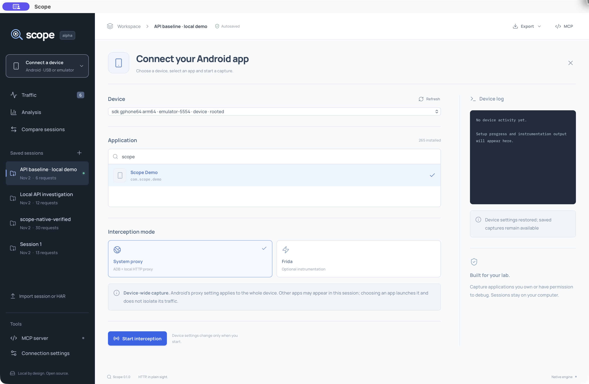

# Screenshots

These images show the actual Scope desktop application with synthetic localhost fixture traffic. They do not show private app captures. The fixture sends real HTTP requests through Scope's capture engine.

## Traffic inspector

## Analysis

## Android application picker

These images are unedited native captures; [capture provenance](images/README.md) records their setup. They document the alpha interface, not universal Android or cross-platform compatibility. See [recorded verification](VERIFICATION.md) for the checks actually performed.
