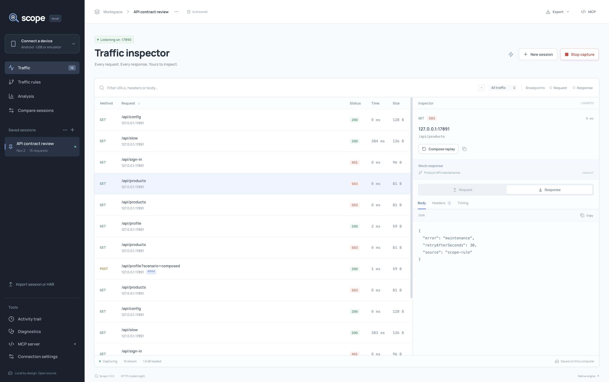
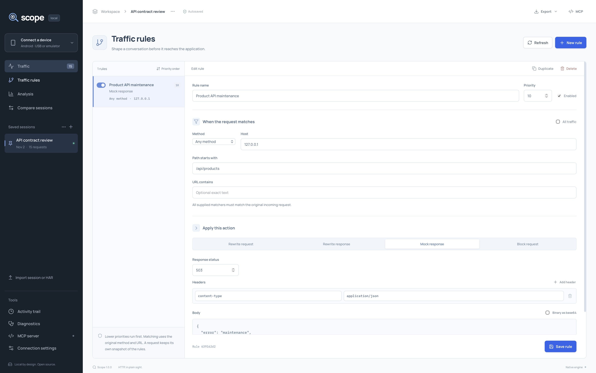
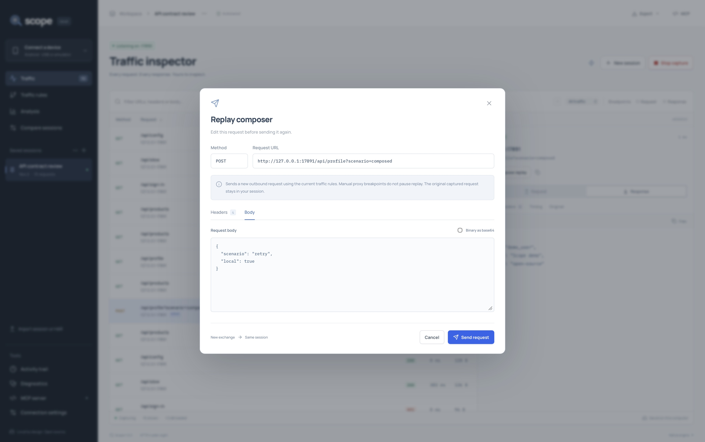
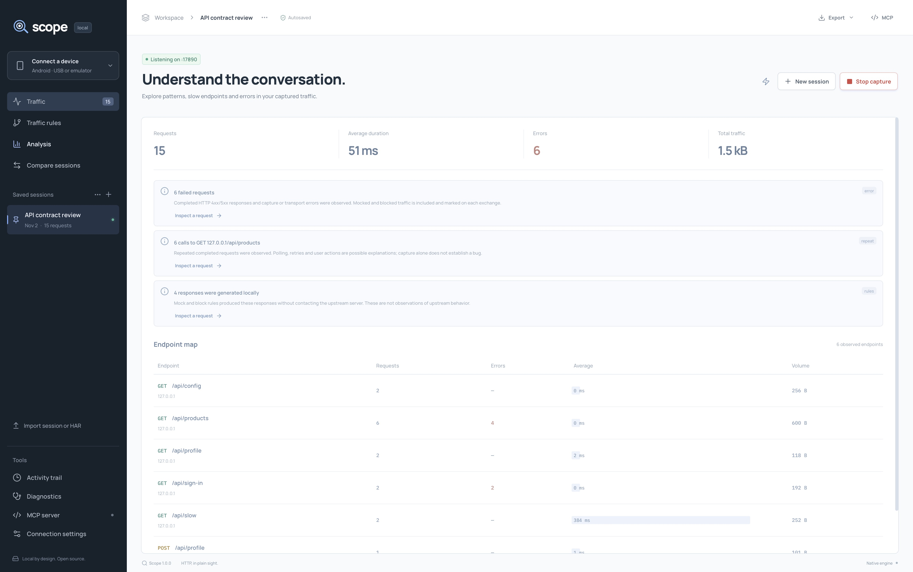

# Screenshots

These images show the actual Scope 1.0.0 native macOS application with synthetic localhost traffic. Every captured exchange was processed by the real engine. The images contain no cursor or capture toolbar and have not been edited.

## Traffic inspector

The session includes local fixture requests, two independently sent curl requests and an edited replay. The selected response was generated by the saved maintenance rule and is marked **Mock response**.

## Traffic rules

The rule matches the original host and path, has explicit priority, and returns a local response. Its HTTP 503 status and maintenance JSON were also verified by the requesting curl client.

## Replay composer

The edited POST was sent successfully, returned HTTP 200, and was saved as a separate exchange. This image reopens that request in the composer. Current rules apply to replay; manual proxy breakpoints do not pause it.

## Analysis

The analysis shows the same 15-exchange session, including four locally generated responses. Findings describe this capture and distinguish rule output from upstream behavior.

See [capture provenance and reproduction](images/README.md) and [recorded verification](VERIFICATION.md) for the setup and checks actually performed. These macOS captures do not establish Windows, Linux or universal Android compatibility.
